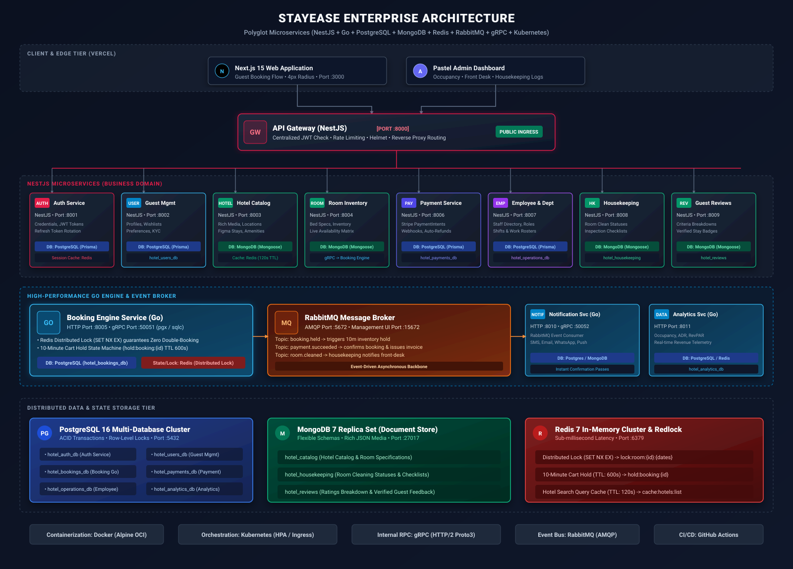
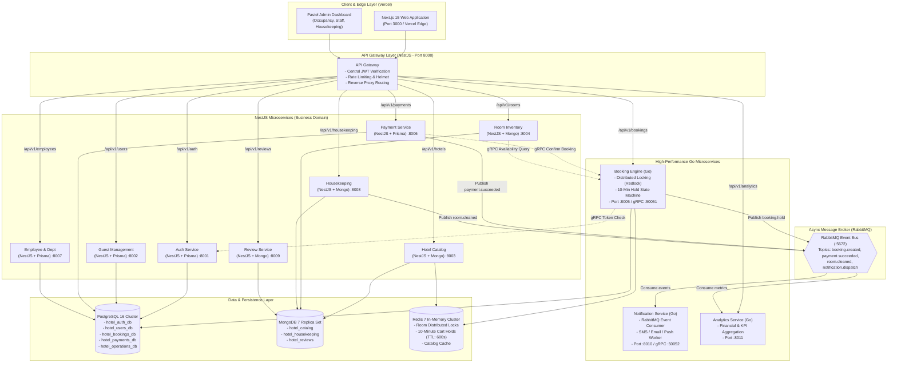
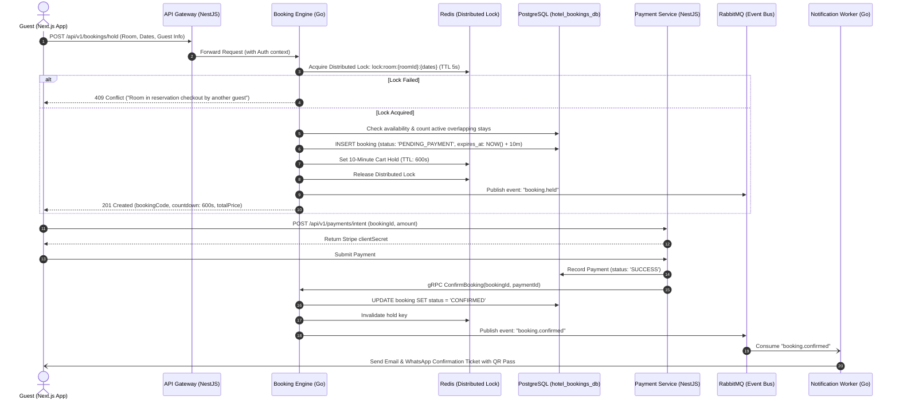

# 🏨 Enterprise Hotel Management Platform — Architecture Blueprint
### Polyglot Microservices (NestJS + Go + PostgreSQL + MongoDB + Redis + RabbitMQ + gRPC + Kubernetes)

> **Visual Diagram**: A vector diagram has been generated at [`architecture-diagram.svg`](./architecture-diagram.svg) and an interactive web viewer at [`architecture-diagram.html`](./architecture-diagram.html).



---

## 1. Enterprise Technology Matrix

| Layer / Service | Technology | Database / State Store | ORM / Driver | Protocols / Ports |
| :--- | :--- | :--- | :--- | :--- |
| **API Gateway** | **NestJS** | — | — | HTTP REST (`:8000`), Rate Limiting, Reverse Proxy |
| **Authentication** | **NestJS** | **PostgreSQL** (`hotel_auth_db`) | **Prisma** | HTTP (`:8001`), gRPC (`:50050`), Redis Session Cache |
| **Guest / User Management** | **NestJS** | **PostgreSQL** (`hotel_users_db`) | **Prisma** | HTTP (`:8002`), Profiles, KYC, Preferences |
| **Hotel Management** | **NestJS** | **MongoDB** (`hotel_catalog`) | **Mongoose** | HTTP (`:8003`), Rich Media, Facilities, Geolocation |
| **Room Management** | **NestJS** | **MongoDB** (`hotel_catalog`) | **Mongoose** | HTTP (`:8004`), Room Layouts, Dynamic Specs |
| **Booking Engine** | **Go (Golang)** | **PostgreSQL** (`hotel_bookings_db`) | **pgx / sqlc** | HTTP (`:8005`), gRPC (`:50051`), Redis Distributed Lock |
| **Payment & Invoicing** | **NestJS** | **PostgreSQL** (`hotel_payments_db`) | **Prisma** | HTTP (`:8006`), Stripe Webhooks, Ledgers |
| **Employee & Department** | **NestJS** | **PostgreSQL** (`hotel_operations_db`) | **Prisma** | HTTP (`:8007`), Staff, Shifts, Permissions |
| **Housekeeping & Maintenance** | **NestJS** | **MongoDB** (`hotel_housekeeping`) | **Mongoose** | HTTP (`:8008`), Cleaning Logs, Checklists |
| **Guest Reviews & Ratings** | **NestJS** | **MongoDB** (`hotel_reviews`) | **Mongoose** | HTTP (`:8009`), Multi-criteria Ratings, Photos |
| **Notifications** | **Go (Golang)** | **MongoDB / PostgreSQL** | **pgx / Mongoose** | HTTP (`:8010`), gRPC (`:50052`), RabbitMQ Consumer |
| **Analytics & Reporting** | **Go (Golang)** | **PostgreSQL / ClickHouse** | **pgx / sqlc** | HTTP (`:8011`), Occupancy, ADR, RevPAR metrics |
| **Distributed Cache & Locks**| **Redis 7** | In-Memory Cluster | `ioredis` / `go-redis` | Port `:6379`, 10-Min Hold TTL, `SET NX EX` locks |
| **Message Broker** | **RabbitMQ** | Disk-Backed AMQP | `amqplib` / `amqp091-go`| Ports `:5672`, Management UI `:15672` |
| **Internal RPC** | **gRPC** | Protocol Buffers (`proto/`) | `@grpc/grpc-js` / `google.golang.org/grpc` | Synchronous high-throughput inter-service RPC |
| **Containerization** | **Docker** | Multi-Stage Alpine Builds | — | OCI compliant container images |
| **Orchestration** | **Kubernetes (K8s)**| Namespaced Manifests (`k8s/`) | — | Ingress-NGINX, Horizontal Pod Autoscalers (HPA) |
| **CI/CD Pipeline** | **GitHub Actions**| Automated CI/CD (`.github/`) | — | Build, Vet, Test, Container Push, Cluster Rollout |

---

## 2. Microservice Topology & Event-Driven Architecture



---

## 3. High-Concurrency Booking & Payment Flow



---

## 4. Local Orchestration (Docker Compose)

The environment starts all data stores, message broker, and microservices in isolated containers with a single command:

```bash
# 1. Start databases, RabbitMQ, Redis, and all microservices
npm run services:up

# 2. Check running services
docker compose -f services/docker-compose.yml ps

# 3. Access RabbitMQ Management Dashboard
# URL: http://localhost:15672
# User: hotel_admin | Password: hotel_rabbit_pass

# 4. Stop all services
npm run services:down
```

---

## 5. Kubernetes Production Deployment (`k8s/`)

Deploying to production on AWS EKS, Google GKE, or self-hosted Kubernetes:

```bash
# 1. Create Namespace & ConfigMaps
kubectl apply -f k8s/namespace.yaml
kubectl apply -f k8s/configmap.yaml

# 2. Deploy Services, StatefulSets, and Ingress
kubectl apply -f k8s/services-deployments.yaml

# 3. Verify Rollout Status
kubectl rollout status deployment/api-gateway -n hotel-platform
kubectl rollout status deployment/booking-service -n hotel-platform
```

---

## 6. Continuous Integration & Deployment (GitHub Actions)

The `.github/workflows/ci-cd.yml` workflow automatically runs on every push:
1. **Frontend Verification**: TypeScript type-checking (`npm run typecheck`) and production build (`npm run build`).
2. **Go Services Validation**: Go static analysis and testing across `booking-service`, `auth-service`, and `user-service`.
3. **Container Build & Registry Publishing**: Multi-stage OCI Docker images pushed to GitHub Container Registry (`ghcr.io`).
4. **Kubernetes Rolling Update**: Automated zero-downtime cluster rollout via `kubectl apply`.
